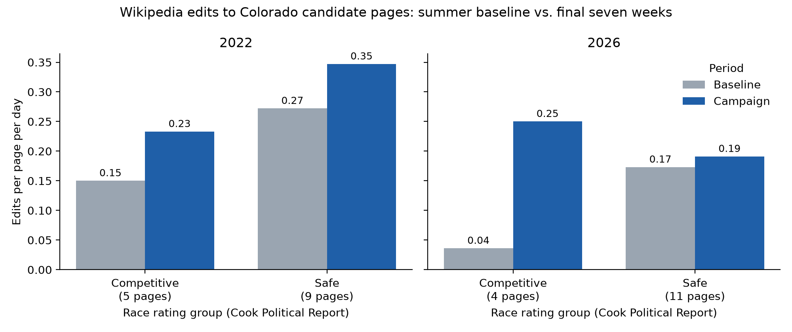

# Edits Before the Vote: Colorado Candidates' Wikipedia Pages in 2026

**Author:** Liku Strom

## Summary

Do Wikipedia pages for Colorado's 2026 candidates get edited more as Election Day gets close? This project covers the governor's race, the US Senate race and all eight US House seats. Using the public MediaWiki Action API and the Wikimedia Pageviews API, I compare edits per day in the last seven weeks of the campaign (September 15 – November 3, 2026) with a summer baseline after the June primary (July 14 – September 14). I also ask whether the increase is larger in competitive races (CO-3, CO-5, CO-8) than in safe ones, what share of edits come from registered versus unregistered (temporary-account) editors, and whether editing simply follows page views. The completed 2022 cycle serves as a pilot and fallback.

Full proposal: [`proposal.md`](proposal.md)

## Data

### Sources

| What | Where it comes from | License |
| --- | --- | --- |
| Edits to each page (time, editor, page size, tags, comment) | MediaWiki Action API, `https://en.wikipedia.org/w/api.php?action=query&prop=revisions` | Wikipedia text is CC BY-SA; I only use edit metadata |
| Daily page views by people (not bots) | Wikimedia Pageviews API, `https://wikimedia.org/api/rest_v1/metrics/pageviews/per-article/en.wikipedia/all-access/user/{title}/daily/{start}/{end}` | CC0 |
| When a page was locked (protected) | MediaWiki Action API, `action=query&list=logevents&letype=protect` | CC BY-SA |
| Bot accounts | MediaWiki Action API, `action=query&list=users&usprop=groups` | CC BY-SA |
| Candidates, page titles, Cook ratings | Typed in by hand from each race's Wikipedia article ([`data/candidates_2026.csv`](data/candidates_2026.csv), [`data/candidates_2022.csv`](data/candidates_2022.csv)), checked with `src/check_pages.py` | |

Every request sends a User-Agent with my contact email, waits one second after each request, and never runs two requests at once. Action API calls add `maxlag=5`, and the code waits whenever it gets a 429 with `Retry-After` (see [`src/wiki_http.py`](src/wiki_http.py)).

### When I collected it

| Cycle | Collected | Window covered | Note |
| --- | --- | --- | --- |
| 2022 (pilot) | Nov 6, 2026 | Jul 12 – Nov 22, 2022 | Finished cycle, complete |
| 2026 | Nov 6, 2026 | Jul 14 – Nov 5, 2026 | Snapshot. The post-election window (Nov 4–17) isn't over yet, so I'll run it again after Nov 17 |

All dates are UTC days.

### How many records

| Table | 2022 | 2026 | One row is |
| --- | --- | --- | --- |
| `pages` | 14 | 15 | a candidate page |
| `edits` | 686 | 335 | one edit |
| `page_days` | 1,876 | 1,725 | one page on one day (edits, views, protection) |
| `protection` | 22 | 20 | one protection log event |

The 2022 cycle has 20 nominees and 14 with pages. 2026 has 21 nominees and 15 with pages. Six House challengers in each cycle have no Wikipedia page, so they aren't in the data. Full per-page counts are in the cleaning logs: [`docs/cleaning_log_2022.md`](docs/cleaning_log_2022.md) and [`docs/cleaning_log_2026.md`](docs/cleaning_log_2026.md).

### What's in the repo

- [`data/sample/`](data/sample/): a 50-row sample of `edits` and a 40-row sample of `page_days` for each cycle, plus the full `pages` and `protection` tables (they're small and have no personal data).
- [`docs/data_dictionary.md`](docs/data_dictionary.md): every field and what it means.
- [`data/page_check_2022.csv`](data/page_check_2022.csv), [`data/page_check_2026.csv`](data/page_check_2026.csv): output of `check_pages.py` (does each page exist, when it was created, is it a redirect).

### What I left out and why

- **Raw API output (`data/raw/`).** It has usernames, IP addresses, temporary-account names and edit comments. Wikipedia shows these publicly, but they are still personal data, and my proposal says raw output never leaves my computer.
- **The full cleaned tables (`data/clean/`).** They have no usernames, but the full `edits` table still has revision IDs and exact timestamps, which link straight back to a username on Wikipedia, and an editor hash, which would let someone follow one editor across pages. The `edits` sample drops all three. I report editors only as counts by type.
- **The hashing salt (`salt.txt`) and my email (`.env`).** Anyone with the salt could re-hash known usernames and match them. My email stays out of the public code; you set your own in `.env`.
- **Size and terms are not the problem here.** The data is small (a few MB) and the licenses allow sharing. The only reason for leaving things out is personal information.

### Things to know about the data

- **Joe O'Dea (2022)** is now a redirect to the 2022 Senate race article. The code collects the history of the `Joe_O'Dea` title itself, not the race article, and uses page size to tell article days from redirect days (`article_live`). In the 2022 window the title was an article on 0 of 70 baseline days, 40 of 50 campaign days and all 14 post days, so his page has no baseline rate to compare against.
- **Adam Frisch (2022)** got his page on July 27, 2022, after the baseline started. Rates for his page should use the days the page existed (`live_days_*` in `pages`), not calendar days.
- **Some pages were protected during the windows.** Lauren Boebert's page was edit-protected on 104 of 134 days in 2022 and 45 of 115 days in 2026 so far. Melat Kiros's page was edit-protected on all 115 days in 2026, and Jared Polis's page on 4 days in 2022. Temporary-account and IP editors can't edit a protected page, so these pages will show fewer unregistered edits. `edit_protection` in `page_days` marks every protected day.
- **Logged-out editors changed in the middle of my comparison.** In 2022 they show up as IP addresses. Since November 4, 2025, English Wikipedia gives them temporary accounts (names starting with `~`). Both count as "unregistered."
- **Bot status is current, not historical.** It comes from each account's user groups at collection time.

## Methods

The analysis is in [`analysis.ipynb`](analysis.ipynb). It reads the cleaned tables and saves its summary tables to [`results/`](results/) and its figures to [`figures/`](figures/).

**The measure.** The periods have different lengths, and two 2022 pages were not articles for the whole window, so I never compare raw counts. For any group of pages I use

> edits per page per day = edits on days the page was a live article ÷ live page-days

where a page-day is one page on one day. The main number is the **campaign-to-baseline ratio**: the campaign rate (final seven weeks, ending on Election Day) divided by the baseline rate (summer, starting two weeks after the primary). A ratio of 1.0 means no change and 2.0 means editing doubled.

**Comparisons.**

- *Competitive vs. safe.* A race is competitive if Cook Political Report rated it Likely or closer (CO-3, CO-5 and CO-8 in 2026); everything rated Solid is safe. The cutoff is set in [`src/config.py`](src/config.py).
- *Incumbents vs. challengers.*
- I compute each comparison two ways. The *pooled* ratio adds up all of a group's edits and page-days first, so busy pages count for more. The *median per-page ratio* (the main number in my proposal) gives every page the same weight, but a page with no baseline edits has no ratio and drops out. The notebook reports how many pages that affects.
- *Weekly timeline.* Edits per page per day in each week, counted back from Election Day so that week 0 is the seven days ending on Election Day.
- *Editor types.* The share of edits from unregistered editors (IP addresses in 2022, temporary accounts in 2026) and the share later reverted (`mw-reverted` tag), by period. Because unregistered editors can't edit a protected page, I repeat the share using only edits made on days the page was not edit-protected.
- *Page views.* Views per page per day by period, the campaign-to-baseline ratio for views next to the ratio for edits, and each page's rank correlation between daily views and daily edits.

**Limits.** This is a description of 15 pages in 2026 and 14 in 2022, not a sample from a larger population, so I report counts, rates and ratios and no significance tests. Only four pages are in the 2026 competitive group, and several pages have fewer than ten edits in a period, so one busy page or one extra edit can move a group's number a lot. Candidates without a Wikipedia page (six House challengers per cycle) are not in the data; in 2026 two of them are in competitive races (CO-3 and CO-5), so those races are each represented by the incumbent only. The 2026 data is still the November 6 snapshot, which ends on November 5.

## Findings

*Preliminary: based on the November 6 snapshot. I will update these after the final collection run (after November 17, 2026).*



**Figure 1.** Edits per page per day in the summer baseline and in the final seven weeks before Election Day, for candidates in competitive races (Cook rating of Likely or closer) and safe races, in 2022 and 2026.

1. **Editing went up before the election, but it did not double.** Across the 15 pages in 2026 there were 129 edits on 945 page-days in the baseline (0.14 edits per page per day) and 155 edits on 750 page-days in the final seven weeks (0.21). That is a ratio of about 1.5, below the "at least double" I expected in my proposal. The 2022 pilot shows a similar, smaller rise (roughly 0.23 to 0.31, a ratio of about 1.3).
2. **The biggest jump comes after the polls close, not before.** In 2022, the two weeks after Election Day had 264 edits on 196 page-days (1.35 edits per page per day), more than four times the campaign rate. The first two days after the 2026 election (November 4–5) already have 51 edits on 30 page-days (1.7 per page per day). I did not predict this in my proposal.
3. **Most edits come from registered accounts.** Unregistered editors made 50 of the 335 edits in 2026 so far (15%, all temporary accounts) and 104 of 686 in 2022 (15%, all IP addresses). Bots made 6 and 23.
4. **Editing is concentrated on a few pages.** In 2026, Victor Marx's page has 89 of the 335 edits, while Jeff Hurd's (CO-3, rated Likely R) has 1. In 2022, Lauren Boebert's and Adam Frisch's pages have 397 of the 686. This is why the group comparisons need care.

The competitive vs. safe and incumbent vs. challenger ratios, the share of edits by editor type in each period, the share reverted, and the page-view comparison are in the notebook's tables and in [`results/`](results/). Figure 2 ([`figures/weekly_timeline.png`](figures/weekly_timeline.png)) shows the weekly timeline.

## How to reproduce

You need Python 3.10 or newer.

```
python -m pip install -r requirements.txt
cp .env.example .env        # then put your own email in .env
```

Run everything from the repo root:

| Step | Command | What it does |
| --- | --- | --- |
| 1 | `python src/check_pages.py 2022` (and `2026`) | Confirms each page title exists and when it was created |
| 2 | `python src/collect.py 2022` (and `2026`) | Downloads raw JSON into `data/raw/` (about 75 requests and 2 minutes per cycle) |
| 3 | `python src/clean.py 2022` (and `2026`) | Builds the tables in `data/clean/`, the samples in `data/sample/`, and the cleaning log in `docs/` |
| 4 | `python -m nbconvert --to notebook --execute --inplace analysis.ipynb` | Runs the analysis notebook from top to bottom and saves the tables in `results/` and the figures in `figures/` |

If the 2026 window isn't over when you run step 2, the data stops at yesterday and is saved as a snapshot. Running `python src/collect.py 2026 --force` after November 17 gets the full window. Your hashes won't match mine, because `clean.py` makes a new random salt the first time it runs.

| File | What it does |
| --- | --- |
| [`src/config.py`](src/config.py) | Study windows, endpoints, pauses, competitive-race cutoff, keyword list |
| [`src/wiki_http.py`](src/wiki_http.py) | The only place requests are made: User-Agent, 1 s pause, maxlag, 429 handling |
| [`src/check_pages.py`](src/check_pages.py) | Checks page titles before collecting |
| [`src/collect.py`](src/collect.py) | Saves raw revisions, page views, protection logs and bot flags |
| [`src/clean.py`](src/clean.py) | Turns raw JSON into tidy, de-identified tables |
| [`analysis.ipynb`](analysis.ipynb) | Rates, ratios, group comparisons, editor types, page views and the figures |
